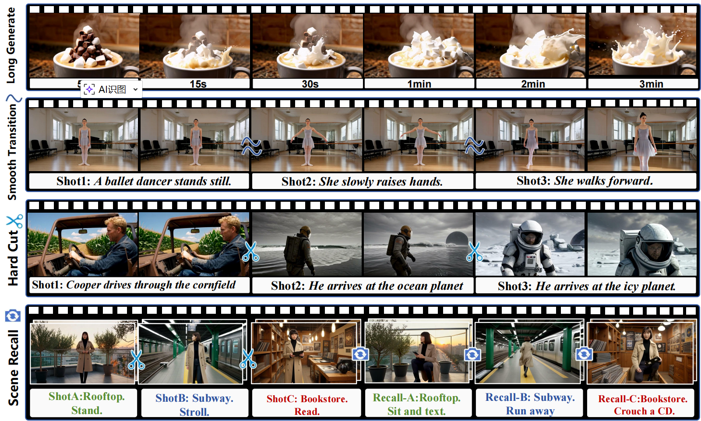
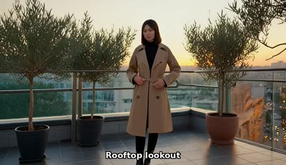
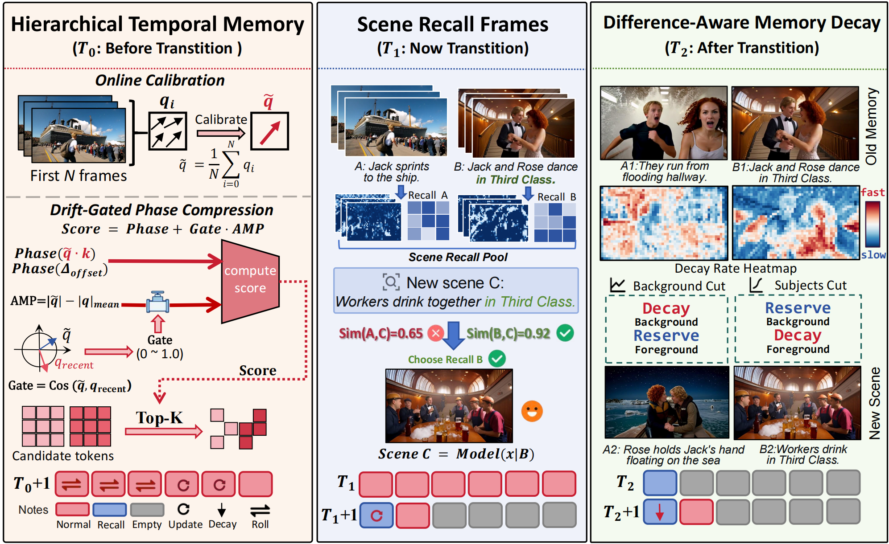
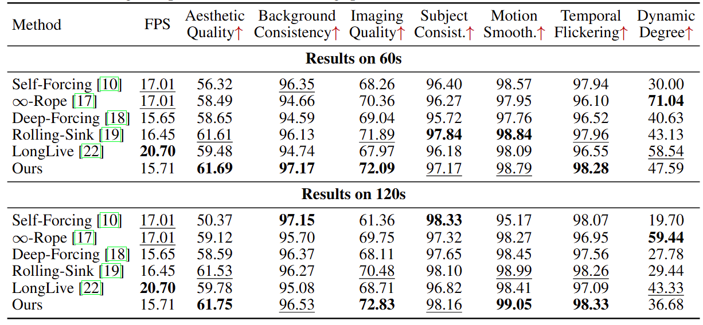
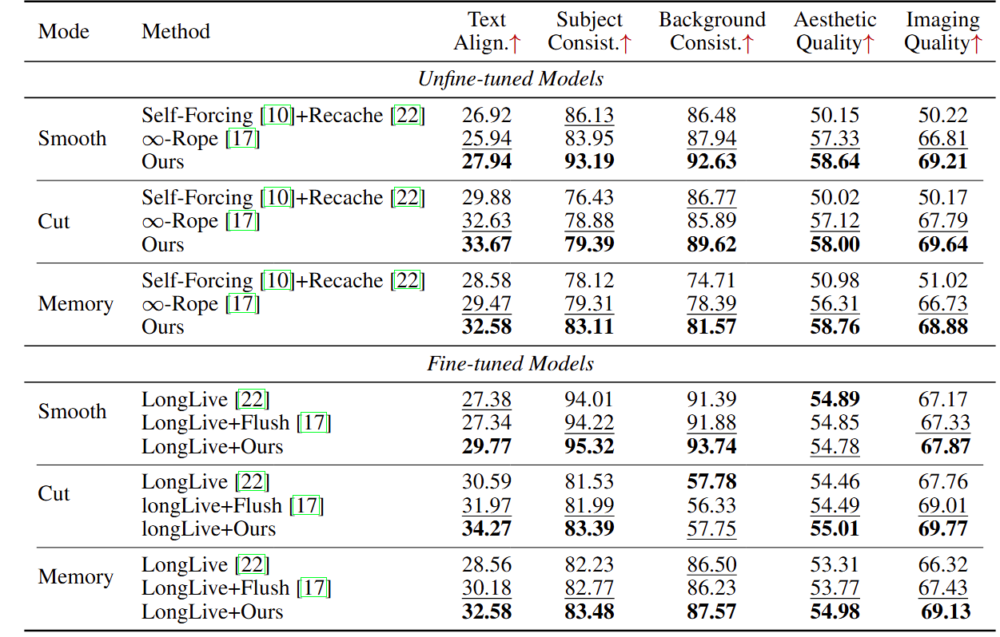
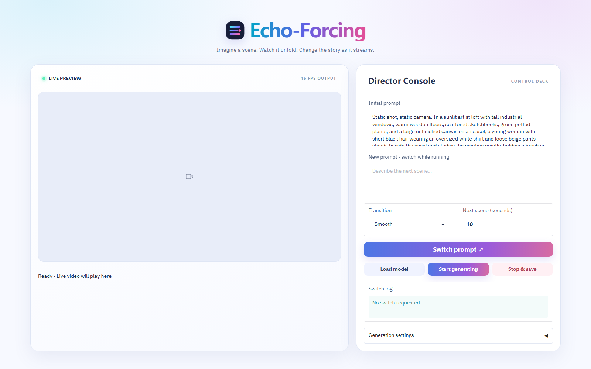

<h1 align="center">🎥 Echo-Forcing: A Scene Memory Framework for Interactive Long Video Generation</h1>
<p align="center">
  <a href="https://arxiv.org/html/2605.16003v1">
    
  </a>
  <a href="https://github.com/mingqiangWu/Echo-Forcing">
    
  </a>
  <a href="https://huggingface.co/papers/2605.16003">
    
  </a>
</p>


<div align="center">
  <strong>
    Mingqiang Wu<sup>1,2,*</sup> |
    Weilun Feng<sup>1,2,*</sup> |
    Zhefeng Zhang<sup>3</sup> |
    Zhulin An<sup>1,&dagger;</sup> 
  </strong>
  <br>
  <strong>
    Haotong Qin<sup>4</sup> |
    Yuqi Li<sup>5</sup> |
    Guoxin Fan<sup>1,2</sup> |
    Xiaokun Liu<sup>1,2</sup>
  </strong>
  <br>
  <strong>
    Chuanguang Yang<sup>1,&dagger;</sup> |
    Libo Huang<sup>1</sup> |
    Yongjun Xu<sup>1</sup>
  </strong>
</div>

<p align="center">
  <sup>*</sup> Equal Contribution &nbsp;&nbsp;
  <sup>&dagger;</sup> Corresponding Authors
</p>

<p align="center">
  1.State Key Laboratory of AI Safety, Institute of Computing Technology, Chinese Academy of Sciences<br>
  2.University of Chinese Academy of Sciences<br>
  3.China University of Mining and Technology, Beijing<br>
  4.ETH Zurich<br>
  5.City College of New York, City University of New York
</p>

<p align="center">
  
</p>

<p align="center">
Echo-Forcing enables training-free interactive long-video generation with preserve, recall, and forget scene memories.
</p>


## 🎥 Video gallery

Click a preview to play the video in your browser. Download the original MP4 files from the [v0.1.0 Release](https://github.com/mingqiangWu/Echo-Forcing/releases/tag/v0.1.0).

<table>
  <tr>
    <td align="center" width="50%"><a href="https://github.com/user-attachments/assets/4bc34606-5690-4ee1-a9bd-e8881cd2a49f"><br><strong>Long video generation · red dress</strong> ▶</a></td>
    <td align="center" width="50%"><a href="https://github.com/user-attachments/assets/9952fb5f-b5db-4a85-9eeb-dc5df1e247b9"><br><strong>Smooth transition</strong> ▶</a></td>
  </tr>
  <tr>
    <td align="center" width="50%"><a href="https://github.com/user-attachments/assets/0016308b-eb30-4c52-ada6-22f4816d50a9"><br><strong>Hard cut</strong> ▶</a></td>
    <td align="center" width="50%"><a href="https://github.com/user-attachments/assets/7ff96d78-0285-4037-bc52-b8499e0f0d3c"><br><strong>Scene recall</strong> ▶</a></td>
  </tr>
</table>

## 📰 News

- **[2026/10/25]** 🚀 Code re-released with the prompt-switch flicker fix, improved transition timing, and streaming inference with a live Gradio demo.
- **[2026/07/24]** The code was temporarily withdrawn for refinement.
- **[2026/05/13]** 🎉 Paper released.

## 📖 Abstract

Autoregressive video diffusion models enable open-ended generation through local attention and KV caching. However, existing training-free long-video optimization methods mainly focus on stable extension under a single prompt, making them difficult to handle interactive scenarios involving prompt switching, old-scene forgetting, and historical scene recall.

We identify the core bottleneck as the functional entanglement of historical KV states: stable anchors and recent dynamics are handled by the same cache policy, leading to outdated background contamination, delayed response to new prompts, and loss of long-range memory.

To address this issue, we propose **Echo-Forcing**, a training-free scene-memory framework specifically designed for interactive long-video generation. Echo-Forcing introduces three core mechanisms:

- **Hierarchical Temporal Memory**, which decouples stable anchors, compressed history, and recent windows under relative RoPE.
- **Scene Recall Frames**, which compress historical scenes into spatially structured KV representations for long-term recall.
- **Difference-aware Memory Decay**, which adaptively forgets conflicting tokens according to the discrepancy between old and new scenes.

With these designs, Echo-Forcing uniformly supports long-horizon generation, smooth transitions, hard cuts, and long-range scene recall under a bounded cache budget.

## 🔍 Method Overview

<p align="center">
  
</p>


<p align="center">
  <strong>Overview of the proposed Echo-Forcing framework.</strong>
  Our method integrates three scene-memory modules to preserve temporal continuity, recall historical scenes, and suppress conflicting memories during interactive long-video generation.
</p>

## 📊 Results

<p align="center">
  
</p>


<p align="center">
Long-video generation on VBench-Long. We compare Echo-Forcing with training-free long-video baselines at 60s and 120s. Echo-Forcing improves visual fidelity and temporal stability while maintaining competitive inference throughput.
</p>
<p align="center">
  
</p>


<p align="center">
Interactive video generation. We evaluate smooth transition, hard cut, and scene recall under both non-fine-tuned and fine-tuned settings. Echo-Forcing consistently improves prompt responsiveness and scene consistency across interaction modes.
</p>


## 🖥️ Streaming demo

Install the streaming UI dependencies after the base environment:

```bash
pip install -r requirements-streaming.txt
bash run_streaming.sh
```

Open `http://127.0.0.1:1325` in your browser. The video player and Director Console remain visible side by side on desktop; narrow screens stack them. The default launcher selects GPU 0 for generation and a second GPU with at least 16 GiB free for VAE decoding. For a single GPU, run `CUDA_VISIBLE_DEVICES=0 bash run_streaming.sh`. To choose a pair, run `CUDA_VISIBLE_DEVICES=0,1 bash run_streaming.sh`.

<p align="center"></p>

The UI accepts a scene plan with duration markers and can switch prompts at the next generation-block boundary. The live player updates as MP4 chunks arrive. Completed runs save `final.mp4` and `metrics.json` under `.streaming_cache/<run-id>/`; generated outputs are ignored by Git. See [STREAMING.md](STREAMING.md) for CLI usage and details.

### Code entry points

| Task | Entry point |
| --- | --- |
| Long video generation | `bash inference.sh` or `python inference.py` |
| Smooth / hard / recall offline generation | `bash inference_smooth.sh`, `bash inference_hard.sh`, `bash inference_recall.sh` |
| Streaming command line | `python inference_stream.py` |
| Streaming Gradio UI | `bash run_streaming.sh` or `python app.py` |

## 🛠️ Installation

Create a conda environment and install the base dependencies:

```bash
conda create -n self_forcing python=3.10 -y
conda activate self_forcing
pip install -r requirements.txt
pip install flash-attn --no-build-isolation
python setup.py develop
```

FlashAttention is optional at runtime: if its installed build is unavailable, attention falls back to PyTorch SDPA. `ffmpeg` is needed to encode streaming MP4 segments.

## 🚀 Quick Start

### 📦 Download Checkpoints

Download the Wan2.1 base model and the Echo-Forcing checkpoint:

```bash
huggingface-cli download Wan-AI/Wan2.1-T2V-1.3B --local-dir-use-symlinks False --local-dir wan_models/Wan2.1-T2V-1.3B
huggingface-cli download gdhe17/Self-Forcing checkpoints/self_forcing_dmd.pt --local-dir .
```

After downloading, the checkpoint files should be placed as follows:

```text
wan_models/Wan2.1-T2V-1.3B/
checkpoints/self_forcing_dmd.pt
```

### 🎞️ Long Video Generation

The long-video demo follows the settings in `inference.sh`:

```bash
python inference.py \
    --config_path configs/self_forcing_dmd.yaml \
    --output_folder ./output/long_video_demo \
    --checkpoint_path checkpoints/self_forcing_dmd.pt \
    --data_path ./prompts/moviegenbench_128_refined.txt \
    --num_output_frames 672 \
    --use_ema \
    --save_with_index \
    --seed 0 \
    --start_idx 0 \
    --end_idx 1
```

### 🧩 Interactive Generation

Smooth transition:

```bash
python inference.py \
    --config_path configs/self_forcing_dmd.yaml \
    --checkpoint_path checkpoints/self_forcing_dmd.pt \
    --output_folder ./output/smooth_demo \
    --data_path ./prompts/prompts_smooth.txt \
    --use_ema \
    --save_with_index \
    --start_idx 0 \
    --end_idx 1
```

Hard cut:

```bash
python inference.py \
    --config_path configs/self_forcing_dmd.yaml \
    --checkpoint_path checkpoints/self_forcing_dmd.pt \
    --output_folder ./output/hard_demo \
    --data_path ./prompts/prompts_hard.txt \
    --use_ema \
    --save_with_index \
    --start_idx 0 \
    --end_idx 1
```

Scene-recall:

```bash
python inference.py \
    --config_path configs/self_forcing_dmd.yaml \
    --checkpoint_path checkpoints/self_forcing_dmd.pt \
    --output_folder ./output/recall_demo \
    --data_path ./prompts/prompts_recall.txt \
    --use_ema \
    --save_with_index \
    --start_idx 0 \
    --end_idx 1
```

## 📝 Prompts and transitions

Each line in a prompt file is one generation example. Long-video generation uses a plain prompt. Interactive plans use scene segments separated by `|`, with a duration marker at the end of each scene:

- `[10s]`: smooth transition after the scene
- `[10s#]`: hard cut after the scene
- `[10s@]`: scene recall after the scene

Example:

```text
A woman studies an unfinished canvas in a sunlit loft[10s] | The same woman begins painting at the easel[10s#] | She returns to the loft and steps back to admire the painting[10s@]
```

The marker describes the transition **after** that scene. For a live prompt switch in Gradio, choose the transition used to enter the new scene. Optional subtitles can follow `;`, with one subtitle per scene separated by `|`.

## 🤖 Scene routing

Echo-Forcing can match a new prompt to an earlier scene using IDF or similarity matching. Configure `interactive.recall.match_method` in [`configs/interactive.yaml`](configs/interactive.yaml). Scene routing is part of inference; offline recall-accuracy evaluation scripts are not included.

## 📜 License and acknowledgements

Echo-Forcing's original contributions are released under the [MIT License](LICENSE). The repository also contains adapted Self-Forcing and Wan2.1 code under Apache 2.0; see [third-party notices](THIRD_PARTY_NOTICES.md) and the [Apache license text](licenses/Apache-2.0.txt).

## 📧 Contact

For questions or suggestions, please open an issue or contact:

- Mingqiang Wu: wumingqiang25e@ict.ac.cn
- Weilun Feng: [fengweilun24s@ict.ac.cn](mailto:fengweilun24s@ict.ac.cn)
- Chuanguang Yang: [yangchuanguang@ict.ac.cn](mailto:yangchuanguang@ict.ac.cn)
- Zhulin An: [anzhulin@ict.ac.cn](mailto:anzhulin@ict.ac.cn)
